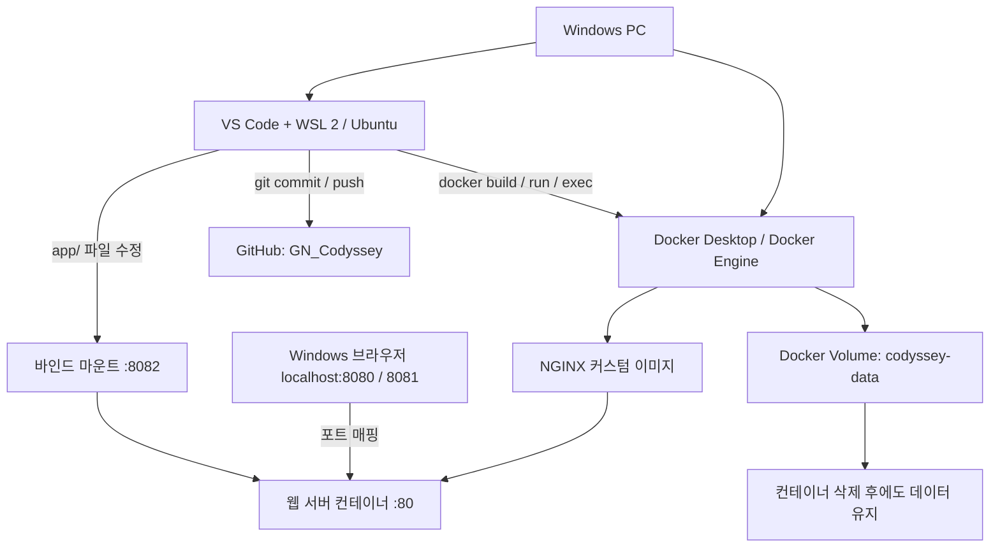
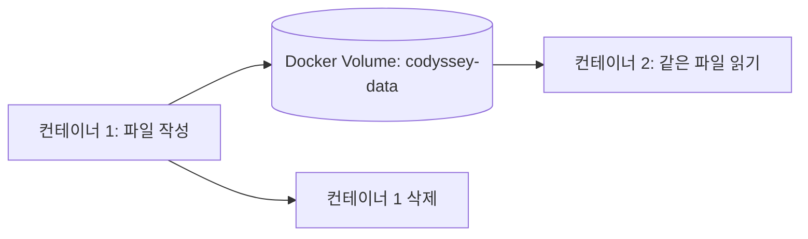

# GN_Codyssey | 개발 워크스테이션 구축

> **코디세이 입학연수 · 개발 입문 필수 미션**  
> Windows PC에서 **WSL 2 · Ubuntu · Docker Desktop · Git/GitHub**를 연결하고, 터미널 실습부터 웹 서버 배포·데이터 영속성까지 검증한 기록입니다.

**한 줄 요약:** Linux 명령으로 프로젝트를 관리하고 → Dockerfile로 같은 웹 서버를 재현하고 → 포트와 스토리지를 연결한 뒤 → GitHub에 실행 증거를 남겼습니다.

## 1. 프로젝트 구성과 실행 흐름



| 실습 구분 | 검증 목적 | 최종 증거 |
|---|---|---|
| Linux CLI / 권한 | 디렉터리·파일 조작, 권한 표기 이해 | [기본 로그](evidence/logs/01-terminal.txt) · [권한 로그](evidence/logs/02-permission.txt) |
| Docker 점검 | Docker CLI와 서버 연결 | [01 설치·서버 버전](evidence/screenshots/01-docker-info.png) |
| Docker 기본 실행 | 이미지, 컨테이너, 상태·로그 구분 | [02 컨테이너](evidence/screenshots/02-docker-basic.png) · [성공 로그](evidence/logs/07-docker-success.txt) |
| Dockerfile | NGINX 기반 커스텀 이미지 제작 | [03 이미지 빌드](evidence/screenshots/03-docker-build.png) |
| 포트 매핑 | 한 이미지로 다른 포트 서비스 | [04 :8080](evidence/screenshots/04-web-8080.png) · [05 :8081](evidence/screenshots/05-web-8081.png) |
| 바인드 마운트 | 호스트 파일 변경의 즉시 반영 | [06 변경 전](evidence/screenshots/06-bind-before.png) · [07 변경 후](evidence/screenshots/07-bind-after.png) · [검증 로그](evidence/logs/08-bind-verification.txt) |
| Docker 볼륨 | 컨테이너를 삭제해도 데이터 유지 | [볼륨 실습 로그](evidence/logs/06-volume.txt) |
| Git / GitHub | 로컬 버전 관리와 원격 저장소 연결 | [08 소스 제어·원격 URL](evidence/screenshots/08-github-vscode.png) |

### 수행 상태 체크리스트

- [x] 경로·파일·디렉터리 명령어 실습
- [x] 파일과 디렉터리 권한 변경
- [x] Docker 설치 및 데몬 점검
- [x] `hello-world`, Ubuntu 컨테이너 실행 및 종료
- [x] Docker 이미지·컨테이너·로그·리소스 확인
- [x] Dockerfile 커스텀 이미지 빌드
- [x] 포트 매핑 8080 / 8081 접속
- [x] 바인드 마운트 변경 전후 비교
- [x] Docker 볼륨 영속성 검증
- [x] Git 커밋 및 GitHub Push
- [x] 실제 트러블슈팅 2건 정리
- [ ] **`git config --list` 결과의 민감정보 마스킹본 첨부 및 기본 브랜치 설정 검증**
- [ ] **VS Code 내 GitHub 계정 로그인 상태 별도 확인** (원격 Git 연결은 확인됨)

> 체크 상태는 업로드된 파일과 실습 화면을 근거로 작성했습니다. 마지막 두 항목은 저장소 연결과는 별도 검증 사항입니다.

---

## 2. 개발 환경

| 구성 요소 | 실제 확인 내용 |
|---|---|
| 호스트 OS | Windows (세부 버전 별도 확인 필요) |
| Linux | WSL 2 + **Ubuntu 26.04.1 LTS** |
| 셸 | Bash |
| 편집기 | VS Code **1.143.0** |
| Git | Ubuntu **2.53.0**, Windows **2.50.0.windows.1** |
| Docker CLI / Server | **29.9.2** |
| Docker Desktop | **4.97.0** (Docker 정보 출력에서 확인) |
| 웹 서버 베이스 | `nginx:alpine` |
| 실습용 Linux 이미지 | `ubuntu:24.04` |
| 저장소 | [Jekt-o/GN_Codyssey](https://github.com/Jekt-o/GN_Codyssey) |

**왜 WSL 2를 사용했나?** Windows에서 Linux의 파일 권한과 Bash 명령어를 직접 실습하면서, Docker Desktop의 Linux 컨테이너 엔진을 Ubuntu 터미널에서 일관되게 제어하기 위해서입니다.

**Docker 엔진 검증**

```bash
docker --version
docker info --format 'Server Version: {{.ServerVersion}}'
```

```text
Docker version 29.9.2, build a82e528
Server Version: 29.9.2
```


---

## 3. Linux CLI · 파일 및 권한

**목표:** 현재 경로 확인, 파일·디렉터리 조작, 파일과 디렉터리 권한 변경을 직접 수행합니다.

```bash
pwd                     # 현재 절대 경로
ls -la                  # 숨김 파일 포함 목록
cd practice             # 상대 경로 이동
mkdir test              # 디렉터리 생성
touch hello.txt         # 빈 파일 생성
echo "Hello Codyssey" > hello.txt
cat hello.txt           # 내용 확인
cp hello.txt copy.txt   # 복사
mv copy.txt renamed.txt # 이름 변경
rm renamed.txt          # 파일 삭제
chmod 600 hello.txt
chmod 644 hello.txt
chmod 700 test
chmod 755 test
rmdir test              # 빈 디렉터리 삭제
```

| 경로·권한 개념 | 예시 | 설명 |
|---|---|---|
| 절대 경로 | `/home/happyjihun/GN_Codyssey` | 파일 시스템 루트에서 시작 |
| 상대 경로 | `app/index.html` | 현재 디렉터리를 기준으로 이동 |
| `r` / `w` / `x` | 4 / 2 / 1 | 읽기 / 쓰기 / 실행·디렉터리 탐색 |
| `644` | `rw-r--r--` | 소유자 읽기·쓰기, 그룹/기타 읽기 |
| `755` | `rwxr-xr-x` | 소유자 전체 권한, 그룹/기타 읽기·탐색 |

파일 권한 **644 → 600 → 644**, 디렉터리 권한 **755 → 700 → 755** 변화를 각각 확인했습니다.

**실행 증거:** [기본 명령어 로그](evidence/logs/01-terminal.txt) · [권한 변경 로그](evidence/logs/02-permission.txt)

---

## 4. Docker 기본 컨테이너 실습

**핵심 개념:** *이미지(Image)*는 실행용 템플릿, *컨테이너(Container)*는 그 이미지를 기반으로 생성된 실행 단위입니다.

```bash
docker run --name codyssey-hello hello-world
docker ps -a
docker logs codyssey-hello
docker run -it --name codyssey-ubuntu ubuntu:24.04 bash
# 컨테이너 내부: pwd, ls, echo "Hello from Ubuntu Container", exit
docker run -d --name codyssey-bg ubuntu:24.04 sleep infinity
docker exec codyssey-bg echo "Container is running"
docker stats --no-stream
docker stop codyssey-bg
docker images
```

| 명령어 | 관찰한 결과 |
|---|---|
| `docker run hello-world` | `Hello from Docker!` 출력 |
| `docker ps -a` | hello-world 및 Ubuntu 컨테이너 `Exited (0)` 표시 |
| `docker run -it ... bash` | Ubuntu 컨테이너 내부 셸에 진입 |
| `docker run -d ...` | 백그라운드 컨테이너 생성 |
| `docker exec` | 실행 중인 컨테이너 내부 명령 수행 |
| `docker stats --no-stream` | CPU·메모리 등 사용량 확인 |
| `docker stop codyssey-bg` | 중지된 컨테이너 `Exited (137)` 확인 |

> `Exited (0)`은 정상 종료를 나타내며, `Exited (137)`은 `SIGKILL` 신호에 의한 종료를 의미합니다. 해당 백그라운드 컨테이너는 `docker stop`으로 중지한 뒤 확인했습니다.


**실행 증거:** [초기 권한 오류 로그](evidence/logs/03-docker-basic.txt) · [권한 해결 후 성공 로그](evidence/logs/07-docker-success.txt)

---

## 5. Dockerfile로 NGINX 커스텀 이미지 만들기

**방식:** 기존 웹 서버 베이스 이미지(`nginx:alpine`)를 이용해 직접 작성한 HTML을 기본 콘텐츠로 복사했습니다.

**[Dockerfile](Dockerfile)**

```dockerfile
FROM nginx:alpine
LABEL org.opencontainers.image.title="GN-Codyssey-Web"
COPY app/ /usr/share/nginx/html/
EXPOSE 80
```

| 설정 | 적용 목적 |
|---|---|
| `FROM nginx:alpine` | 경량 NGINX 이미지 활용 |
| `LABEL` | 커스텀 이미지 식별 |
| `COPY app/...` | 직접 만든 [index.html](app/index.html) 배포 |
| `EXPOSE 80` | 컨테이너 서비스 포트 명시 (호스트 공개 설정은 아님) |

```bash
docker build -t gn-codyssey-web:1.0 .
docker images
```

빌드 결과에서 `FINISHED`와 생성된 `gn-codyssey-web:1.0` 이미지를 확인했습니다.


**실행 증거:** [빌드 로그](evidence/logs/04-dockerfile.txt) · [Dockerfile](Dockerfile) · [HTML](app/index.html)

---

## 6. 포트 매핑: 하나의 이미지, 두 개의 웹 서버

**왜 필요한가?** 컨테이너의 내부 HTTP 포트 80번을 Windows 브라우저가 접근할 수 있도록 호스트 포트에 연결하기 때문입니다.

```text
Windows localhost:8080 ──→ NGINX 컨테이너 A :80
Windows localhost:8081 ──→ NGINX 컨테이너 B :80
                    (동일 이미지 gn-codyssey-web:1.0)
```

```bash
docker run -d --name gn-codyssey-web -p 8080:80 gn-codyssey-web:1.0
docker run -d --name gn-codyssey-web-8081 -p 8081:80 gn-codyssey-web:1.0
docker ps
curl http://localhost:8080
curl http://localhost:8081
```

| 8080번 포트 | 8081번 포트 |
|---|---|
|  |  |

두 포트 모두 직접 제작한 정적 웹 페이지에 접속할 수 있음을 확인했습니다. **브라우저 주소창과 응답 화면을 함께 캡처**했습니다.

---

## 7. 바인드 마운트: 재빌드 없이 즉시 변경 반영

**목표:** 호스트의 `app/index.html`을 수정할 때 실행 중인 웹 서버의 페이지가 바뀌는지 확인합니다.

```bash
docker run -d --name gn-codyssey-bind -p 8082:80 --mount type=bind,src="$(pwd)/app",dst=/usr/share/nginx/html,readonly gn-codyssey-web:1.0
curl http://localhost:8082
```

`readonly` 옵션으로 컨테이너 내부에서 원본 파일을 수정하지 못하게 하면서 호스트 쪽 변경 사항은 읽을 수 있게 했습니다.

| 변경 전 | 변경 후 |
|---|---|
|  |  |
| `Custom Docker Image Successfully Running!` | `Bind Mount Updated Successfully!` |

**결론:** 이미지를 다시 빌드하거나 컨테이너를 재시작하지 않아도 변경된 HTML이 `localhost:8082`에 반영됐습니다.

**실행 증거:** [마운트 생성 로그](evidence/logs/05-bind-mount.txt) · [변경 후 curl 검증 로그](evidence/logs/08-bind-verification.txt) · [변경 전 HTML 백업](practice/index-before-bind.html)

---

## 8. Docker 볼륨: 컨테이너를 삭제해도 데이터 유지

**핵심 차이:** 바인드 마운트는 *지정한 호스트 경로*를 공유하고, 볼륨은 *Docker가 관리하는 스토리지*에 데이터를 보존합니다.



```bash
docker volume create codyssey-data
docker run -d --name codyssey-vol-1 -v codyssey-data:/data ubuntu:24.04 sleep infinity
docker exec codyssey-vol-1 sh -c 'echo "Persistent Data" > /data/test.txt'
docker exec codyssey-vol-1 cat /data/test.txt
# 출력: Persistent Data
docker rm -f codyssey-vol-1
docker run -d --name codyssey-vol-2 -v codyssey-data:/data ubuntu:24.04 sleep infinity
docker exec codyssey-vol-2 cat /data/test.txt
# 출력: Persistent Data
docker volume inspect codyssey-data
```

| 확인 시점 | 결과 |
|---|---|
| 컨테이너 1 삭제 전 | `Persistent Data` |
| 컨테이너 1 삭제 후, 컨테이너 2에서 읽기 | `Persistent Data` |

**결론:** 컨테이너를 삭제해도 별도로 관리되는 볼륨에는 데이터가 남았습니다.

**실행 증거:** [볼륨 생성·삭제·재연결 및 검증 로그](evidence/logs/06-volume.txt)

---

## 9. Git / GitHub / VS Code 연결

| 구성 | 역할 |
|---|---|
| Git | 로컬 작업 변경 사항 기록 및 버전 관리 |
| GitHub | 원격 저장소에 커밋 공유 |
| VS Code 소스 제어 | 수정 사항 확인, 스테이징, 커밋 이력 확인 |

```bash
git status
git remote -v
git branch --show-current
git add .
git commit -m "Add workstation verification evidence"
git push origin main
```

실제 `origin`은 [Jekt-o/GN_Codyssey](https://github.com/Jekt-o/GN_Codyssey)를 가리키며 `main` 브랜치에 실습 자료가 올라왔습니다.


> 보완 필요: 과제에서 요구하는 **`git config --list` 결과 기록**, Git 기본 브랜치·사용자 정보 검증, **VS Code 계정 메뉴에서 GitHub 로그인 확인**은 별도로 남깁니다. 위 사진은 원격 저장소·소스 제어 연결을 증명하지만 계정 로그인 자체를 단독 증명하지는 않습니다.

---

## 10. 실제 발생한 트러블슈팅

### 사례 1 — Docker 접근 권한 오류

| 단계 | 수행 내용 |
|---|---|
| **문제** | `docker run` 중 `permission denied ... /var/run/docker.sock` 발생 |
| **원인 가설** | Ubuntu 사용자에게 Docker 소켓 그룹 권한이 없음 |
| **확인** | `ls -l /var/run/docker.sock` → `root docker`, `id -nG` → 초기 그룹 목록에 `docker` 없음 |
| **해결** | `sudo usermod -aG docker "$USER"` 후 WSL 종료·재실행으로 그룹 변경 적용 |
| **재검증** | `id -nG`에 `docker` 포함, `docker ps` 정상 동작, `hello-world` 실행 성공 |

그룹 권한을 변경한 직후 기존 WSL 세션에서는 오류가 이어졌으나, **WSL 재시작 후 해결**됐습니다. Docker 그룹에는 높은 권한이 있으므로 개인 개발 PC의 설정 변경 시 주의가 필요합니다.

### 사례 2 — GitHub HTTPS 인증 실패

| 단계 | 수행 내용 |
|---|---|
| **문제** | `git push` 과정에서 GitHub 사용자 이름·비밀번호 요청 |
| **원인 가설** | WSL Ubuntu의 Git HTTPS 인증이 구성되지 않음 |
| **확인** | Git Credential Manager 명령을 찾지 못하고, 일반 계정 비밀번호 방식으로 진행할 수 없음을 확인 |
| **해결** | `gh auth login --web --git-protocol https` 실행, GitHub 기기 인증, `gh auth setup-git` |
| **재검증** | `git push origin main` 성공 및 GitHub 저장소의 실제 파일 업데이트 확인 |

인증 과정의 **일회용 코드, 비밀번호, 인증 토큰은 README와 증거에 포함하지 않았습니다.**

---

## 11. 재현 방법 및 주의사항

다른 PC에서도 다음처럼 동일한 웹 서버 이미지를 만들고 접속할 수 있습니다. Docker Desktop과 WSL 2·Docker 엔진을 먼저 준비해야 합니다.

```bash
git clone https://github.com/Jekt-o/GN_Codyssey.git
cd GN_Codyssey
docker build -t gn-codyssey-web:1.0 .
docker run -d --name gn-codyssey-review -p 8080:80 gn-codyssey-web:1.0
curl http://localhost:8080
docker logs gn-codyssey-review
```

- 다른 프로그램이 8080 포트를 사용한다면 호스트 포트만 변경: `-p 8090:80`
- 동일한 컨테이너 이름이 있으면 새 이름을 사용하거나 기존 컨테이너를 확인한 뒤 정리
- 바인드 마운트의 `$(pwd)/app` 경로는 **프로젝트 루트에서 실행**한 경우의 예시
- 저장소에는 실행에 필요한 원본 코드가 들어 있으며, Docker 이미지 자체를 저장소에 업로드하는 구조는 아님
- 공개 저장소에 로그를 추가하기 전 비밀번호, 토큰, 인증 코드, 개인키 등 노출 여부 점검

## 12. 최종 보완 체크

- [x] 필수 소스·Dockerfile·로그 8개·스크린샷 8개 GitHub 업로드
- [x] Docker 권한 오류 해결 뒤 성공 기록 보강
- [x] 포트 매핑 및 바인드 마운트 전후 화면 연결
- [x] 볼륨 영속성 검증 로그 연결
- [x] 트러블슈팅 2건 작성
- [ ] `git config --list`의 실제 실행·마스킹 결과 추가
- [ ] Git 기본 브랜치 설정 및 VS Code GitHub 계정 로그인 검증 결과 추가
- [ ] Windows 정확한 버전 확인 후 실행 환경 표 보완

---

**실습 결론:** Linux CLI로 파일과 권한을 관리하고, Dockerfile로 재현 가능한 NGINX 이미지를 만들었으며, 포트 매핑·바인드 마운트·Docker 볼륨을 통해 외부 접속과 데이터 저장 방식을 검증했습니다. 모든 핵심 산출물은 이 GitHub 저장소의 소스·로그·스크린샷에서 확인할 수 있습니다.
