# GN_Codyssey | 개발 워크스테이션 구축

> **코디세이 입학연수 · 개발 입문 필수 미션**  
> Windows PC에서 **WSL 2 · Ubuntu · Docker Desktop · Git/GitHub**를 연결하고, 터미널 실습부터 웹 서버 배포·데이터 영속성까지 검증한 기록입니다.

**한 줄 요약:** Linux 명령으로 프로젝트를 관리하고 → Dockerfile로 같은 웹 서버를 재현하고 → 포트와 스토리지를 연결한 뒤 → GitHub에 실행 증거를 남겼습니다.

## 1. 프로젝트 구성과 실행 흐름

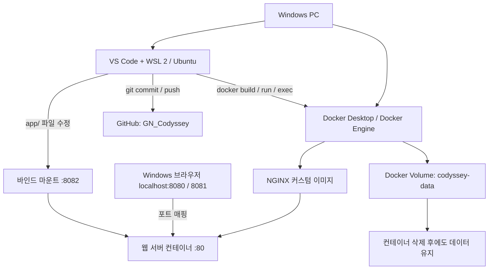

| 실습 구분 | 검증 목적 | 최종 증거 |
|---|---|---|
| Linux CLI / 권한 | 디렉터리·파일 조작, 권한 표기 이해 | [기본 로그](evidence/logs/01-terminal.txt) · [권한 로그](evidence/logs/02-permission.txt) |
| Docker 점검 | Docker CLI와 서버 연결 | [01 설치·서버 버전](evidence/screenshots/01-docker-info.png) |
| Docker 기본 실행 | 이미지, 컨테이너, 상태·로그 구분 | [02 컨테이너](evidence/screenshots/02-docker-basic.png) · [성공 로그](evidence/logs/07-docker-success.txt) |
| Dockerfile | NGINX 기반 커스텀 이미지 제작 | [03 이미지 빌드](evidence/screenshots/03-docker-build.png) |
| 포트 매핑 | 한 이미지로 다른 포트 서비스 | [04 :8080](evidence/screenshots/04-web-8080.png) · [05 :8081](evidence/screenshots/05-web-8081.png) |
| 바인드 마운트 | 호스트 파일 변경의 즉시 반영 | [06 변경 전](evidence/screenshots/06-bind-before.png) · [07 변경 후](evidence/screenshots/07-bind-after.png) · [검증 로그](evidence/logs/08-bind-verification.txt) |
| Docker 볼륨 | 컨테이너를 삭제해도 데이터 유지 | [볼륨 실습 로그](evidence/logs/06-volume.txt) |
| Git / GitHub | 로컬 버전 관리와 원격 저장소 연결 | [08 소스 제어·원격 URL](evidence/screenshots/08-github-vscode.png) |

### 수행 상태 체크리스트

- [x] 경로·파일·디렉터리 명령어 실습
- [x] 파일과 디렉터리 권한 변경
- [x] Docker 설치 및 데몬 점검
- [x] `hello-world`, Ubuntu 컨테이너 실행 및 종료
- [x] Docker 이미지·컨테이너·로그·리소스 확인
- [x] Dockerfile 커스텀 이미지 빌드
- [x] 포트 매핑 8080 / 8081 접속
- [x] 바인드 마운트 변경 전후 비교
- [x] Docker 볼륨 영속성 검증
- [x] Git 커밋 및 GitHub Push
- [x] 실제 트러블슈팅 2건 정리
- [x] **`git config --list` 주요 설정값 기록(이메일 마스킹) 및 기본 브랜치 설정 검증**
- [x] **VS Code GitHub 계정 `Jekt-o` 로그인 확인**

> 체크 상태는 GitHub에 업로드된 실제 파일과 실습 화면에 근거합니다. Git 설정 로그는 전체 설정 원문이 아니라 인증·개인정보 보호를 위해 **관련 항목만 선별하고 이메일을 마스킹한 결과**입니다.

---

## 2. 개발 환경

| 구성 요소 | 실제 확인 내용 |
|---|---|
| 호스트 OS | Windows (세부 버전 별도 확인 필요) |
| Linux | WSL 2 + **Ubuntu 26.04.1 LTS** |
| 셸 | Bash |
| 편집기 | VS Code **1.143.0** |
| Git | Ubuntu **2.53.0**, Windows **2.50.0.windows.1** |
| Docker CLI / Server | **29.9.2** |
| Docker Desktop | **4.97.0** (Docker 정보 출력에서 확인) |
| 웹 서버 베이스 | `nginx:alpine` |
| 실습용 Linux 이미지 | `ubuntu:24.04` |
| 저장소 | [Jekt-o/GN_Codyssey](https://github.com/Jekt-o/GN_Codyssey) |

**왜 WSL 2를 사용했나?** Windows에서 Linux의 파일 권한과 Bash 명령어를 직접 실습하면서, Docker Desktop의 Linux 컨테이너 엔진을 Ubuntu 터미널에서 일관되게 제어하기 위해서입니다.

**Docker 엔진 검증**

```bash
docker --version
docker info --format 'Server Version: {{.ServerVersion}}'
```

```text
Docker version 29.9.2, build a82e528
Server Version: 29.9.2
```

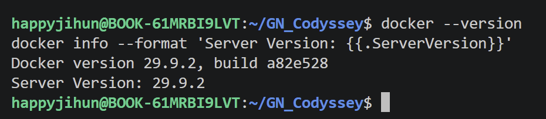

---

## 3. Linux CLI · 파일 및 권한

**목표:** 현재 경로 확인, 파일·디렉터리 조작, 파일과 디렉터리 권한 변경을 직접 수행합니다.

```bash
pwd                     # 현재 절대 경로
ls -la                  # 숨김 파일 포함 목록
cd practice             # 상대 경로 이동
mkdir test              # 디렉터리 생성
touch hello.txt         # 빈 파일 생성
echo "Hello Codyssey" > hello.txt
cat hello.txt           # 내용 확인
cp hello.txt copy.txt   # 복사
mv copy.txt renamed.txt # 이름 변경
rm renamed.txt          # 파일 삭제
chmod 600 hello.txt
chmod 644 hello.txt
chmod 700 test
chmod 755 test
rmdir test              # 빈 디렉터리 삭제
```

| 경로·권한 개념 | 예시 | 설명 |
|---|---|---|
| 절대 경로 | `/home/happyjihun/GN_Codyssey` | 파일 시스템 루트에서 시작 |
| 상대 경로 | `app/index.html` | 현재 디렉터리를 기준으로 이동 |
| `r` / `w` / `x` | 4 / 2 / 1 | 읽기 / 쓰기 / 실행·디렉터리 탐색 |
| `644` | `rw-r--r--` | 소유자 읽기·쓰기, 그룹/기타 읽기 |
| `755` | `rwxr-xr-x` | 소유자 전체 권한, 그룹/기타 읽기·탐색 |

파일 권한 **644 → 600 → 644**, 디렉터리 권한 **755 → 700 → 755** 변화를 각각 확인했습니다.

**실행 증거:** [기본 명령어 로그](evidence/logs/01-terminal.txt) · [권한 변경 로그](evidence/logs/02-permission.txt)

---

## 4. Docker 기본 컨테이너 실습

**핵심 개념:** *이미지(Image)*는 실행용 템플릿, *컨테이너(Container)*는 그 이미지를 기반으로 생성된 실행 단위입니다.

```bash
docker run --name codyssey-hello hello-world
docker ps -a
docker logs codyssey-hello
docker run -it --name codyssey-ubuntu ubuntu:24.04 bash
# 컨테이너 내부: pwd, ls, echo "Hello from Ubuntu Container", exit
docker run -d --name codyssey-bg ubuntu:24.04 sleep infinity
docker exec codyssey-bg echo "Container is running"
docker stats --no-stream
docker stop codyssey-bg
docker images
```

| 명령어 | 관찰한 결과 |
|---|---|
| `docker run hello-world` | `Hello from Docker!` 출력 |
| `docker ps -a` | hello-world 및 Ubuntu 컨테이너 `Exited (0)` 표시 |
| `docker run -it ... bash` | Ubuntu 컨테이너 내부 셸에 진입 |
| `docker run -d ...` | 백그라운드 컨테이너 생성 |
| `docker exec` | 실행 중인 컨테이너 내부 명령 수행 |
| `docker stats --no-stream` | CPU·메모리 등 사용량 확인 |
| `docker stop codyssey-bg` | 중지된 컨테이너 `Exited (137)` 확인 |

> `Exited (0)`은 정상 종료를 나타내며, `Exited (137)`은 `SIGKILL` 신호에 의한 종료를 의미합니다. 해당 백그라운드 컨테이너는 `docker stop`으로 중지한 뒤 확인했습니다.

### 컨테이너 종료·유지 원리와 `attach` / `exec` 차이 — 동료평가 피드백 반영

**핵심 원리:** 컨테이너의 실행 상태는 **주 프로세스(PID 1)**가 계속 동작하는지에 따라 결정됩니다. 터미널에서 나왔다고 무조건 컨테이너가 종료되는 것은 아닙니다.

| 구분 | 어떤 동작인가? | 종료·유지에 미치는 영향 |
|---|---|---|
| `docker run -it ... bash` | 새 컨테이너를 만들고 **주 프로세스인 Bash**에 접속 | Bash에서 `exit`하면 주 프로세스가 끝나므로 컨테이너도 종료 |
| `docker run -d ... sleep infinity` | 주 프로세스를 백그라운드에서 계속 실행 | 터미널로 돌아와도 `sleep infinity`가 실행 중이므로 컨테이너 유지 |
| `docker attach 컨테이너명` | **이미 실행 중인 주 프로세스의 입출력**에 현재 터미널을 연결 | 주 프로세스인 Bash에서 `exit`하면 컨테이너도 종료될 수 있음 |
| `docker exec -it 컨테이너명 bash` | 실행 중인 컨테이너 **안에서 새로운 Bash 프로세스**를 별도로 실행 | 새 Bash에서 `exit`하더라도 주 프로세스가 계속 실행 중이면 컨테이너 유지 |
| `docker stop 컨테이너명` | 주 프로세스에 종료 신호를 보내 컨테이너 중지 | 컨테이너가 중지됨. 정상 종료되지 않으면 유예 시간 뒤 강제 종료될 수 있음 |

**`attach`와 `exec`를 구분하는 가장 쉬운 방법:** `attach`는 *원래 실행 중이던 프로그램의 터미널에 다시 연결*하는 것이고, `exec`는 *실행 중인 컨테이너에 새로운 명령어를 추가로 실행*하는 것입니다.

**컨테이너를 계속 실행해 두고 터미널만 빠져나오려면?** 대화형 TTY에 `attach`된 상태에서는 기본 분리 키인 **`Ctrl + P`를 누른 뒤 `Ctrl + Q`**로 연결을 해제(detach)할 수 있습니다. `exit`는 연결 해제가 아니라 현재 셸을 종료하는 명령이므로 둘을 구분해야 합니다. 이 키 조합은 Docker의 기본 detach 키 설정을 전제로 합니다.

**동작 차이를 확인하는 재현 예시 (기존 제출 실습과 별도이며, 아래 명령의 실행 성공을 주장하는 증거는 아님)**

```bash
# 1. 주 프로세스(Bash)를 백그라운드에서 실행
docker run -dit --name codyssey-attach-demo ubuntu:24.04 bash

# 2. 별도의 셸을 열었다가 exit: 주 프로세스가 살아 있어 컨테이너 유지
docker exec -it codyssey-attach-demo bash
# (컨테이너 안에서) exit
docker ps --filter name=codyssey-attach-demo

# 3. 원래 주 프로세스에 연결
docker attach codyssey-attach-demo
# (연결된 상태에서) Ctrl+P, Ctrl+Q: 종료하지 않고 분리
docker ps --filter name=codyssey-attach-demo

# 4. 실습 후 컨테이너 정리
docker stop codyssey-attach-demo
docker rm codyssey-attach-demo
```

> **핵심 정리:** `exit`의 결과는 **어떤 셸에서 실행했는가**에 달려 있습니다. 컨테이너의 주 프로세스가 종료되면 컨테이너도 종료되지만, `docker exec`로 추가 실행한 셸만 끝나면 주 프로세스가 살아 있는 한 컨테이너는 계속 실행됩니다. `docker ps`는 실행 중인 컨테이너, `docker ps -a`는 종료된 컨테이너까지 확인하는 명령어입니다.

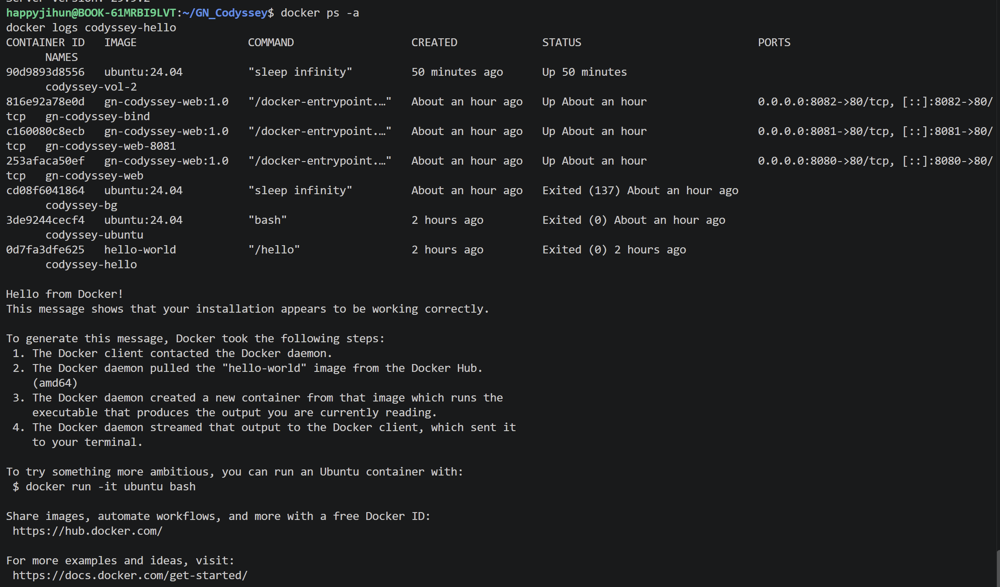

**실행 증거:** [초기 권한 오류 로그](evidence/logs/03-docker-basic.txt) · [권한 해결 후 성공 로그](evidence/logs/07-docker-success.txt)

---

## 5. Dockerfile로 NGINX 커스텀 이미지 만들기

**방식:** 기존 웹 서버 베이스 이미지(`nginx:alpine`)를 이용해 직접 작성한 HTML을 기본 콘텐츠로 복사했습니다.

**[Dockerfile](Dockerfile)**

```dockerfile
FROM nginx:alpine
LABEL org.opencontainers.image.title="GN-Codyssey-Web"
COPY app/ /usr/share/nginx/html/
EXPOSE 80
```

| 설정 | 적용 목적 |
|---|---|
| `FROM nginx:alpine` | 경량 NGINX 이미지 활용 |
| `LABEL` | 커스텀 이미지 식별 |
| `COPY app/...` | 직접 만든 [index.html](app/index.html) 배포 |
| `EXPOSE 80` | 컨테이너 서비스 포트 명시 (호스트 공개 설정은 아님) |

```bash
docker build -t gn-codyssey-web:1.0 .
docker images
```

빌드 결과에서 `FINISHED`와 생성된 `gn-codyssey-web:1.0` 이미지를 확인했습니다.

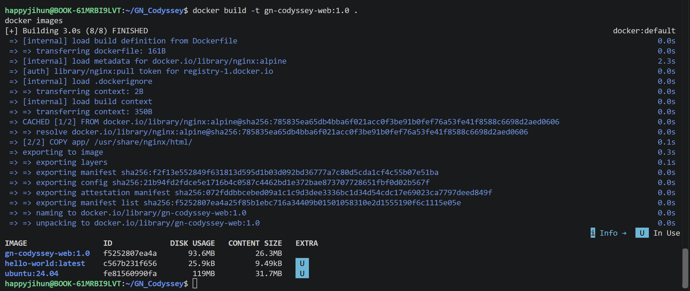

**실행 증거:** [빌드 로그](evidence/logs/04-dockerfile.txt) · [Dockerfile](Dockerfile) · [HTML](app/index.html)

---

## 6. 포트 매핑: 하나의 이미지, 두 개의 웹 서버

**왜 필요한가?** 컨테이너의 내부 HTTP 포트 80번을 Windows 브라우저가 접근할 수 있도록 호스트 포트에 연결하기 때문입니다.

### 네트워크 네임스페이스(Network Namespace)와 포트 포워딩 — 평가 항목 #13

**네트워크 네임스페이스**는 Linux에서 네트워크 인터페이스, IP 주소, 라우팅 테이블, 포트 바인딩 등의 네트워크 자원을 격리하는 기능입니다. Docker의 기본 `bridge` 네트워크에서는 각 컨테이너가 별도의 네트워크 네임스페이스를 사용하므로, **컨테이너 내부의 `:80`에서 실행되는 NGINX가 호스트의 `:80`에 자동 노출되는 것은 아닙니다.** 따라서 외부에서 접속하려면 호스트 포트와 컨테이너 포트를 연결하는 포트 포워딩(포트 게시)이 필요합니다.

```text
Windows 브라우저 localhost:8080
             │  (호스트 포트)
             ▼
Docker Desktop 포트 포워딩 (-p 8080:80)
             │  Windows → Linux VM → 컨테이너
             ▼
컨테이너의 네트워크 네임스페이스
  └── NGINX가 컨테이너 내부 :80에서 HTTP 요청 처리
```

- `-p 8080:80`: **호스트 8080 → 컨테이너 80** 연결. `-p 8081:80`도 독립된 다른 컨테이너의 80번 포트로 전달할 수 있습니다.
- `EXPOSE 80`은 이미지가 사용하는 포트의 선언일 뿐, 호스트 포트를 자동으로 열지 않습니다.
- Docker Desktop(Windows)은 호스트 포트로 들어온 접속을 내부 Linux 환경의 컨테이너로 전달합니다. 포트 게시가 없는 일반 `bridge` 컨테이너는 Windows 브라우저가 해당 서비스 포트로 직접 접속할 수 없습니다.
- `-p 8080:80`은 기본적으로 모든 호스트 인터페이스에 게시될 수 있으므로, 로컬 개발 전용이라면 `-p 127.0.0.1:8080:80`으로 제한할 수 있습니다.

**공식 참고:** [Docker — Port publishing and mapping](https://docs.docker.com/engine/network/port-publishing/) · [Docker Desktop — Networking](https://docs.docker.com/desktop/features/networking/)

```text
Windows localhost:8080 ──→ NGINX 컨테이너 A :80
Windows localhost:8081 ──→ NGINX 컨테이너 B :80
                    (동일 이미지 gn-codyssey-web:1.0)
```

```bash
docker run -d --name gn-codyssey-web -p 8080:80 gn-codyssey-web:1.0
docker run -d --name gn-codyssey-web-8081 -p 8081:80 gn-codyssey-web:1.0
docker ps
curl http://localhost:8080
curl http://localhost:8081
```

| 8080번 포트 | 8081번 포트 |
|---|---|
| 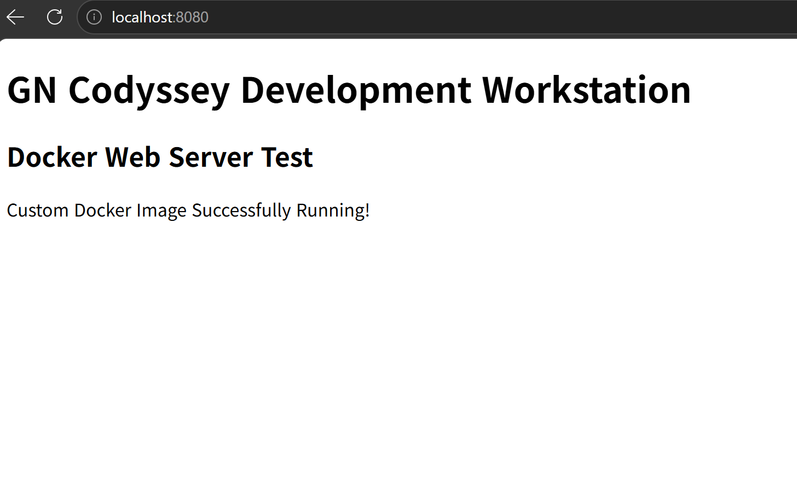 | 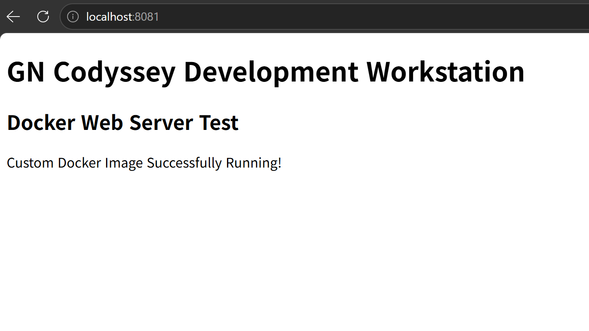 |

두 포트 모두 직접 제작한 정적 웹 페이지에 접속할 수 있음을 확인했습니다. **브라우저 주소창과 응답 화면을 함께 캡처**했습니다.

---

## 7. 바인드 마운트: 재빌드 없이 즉시 변경 반영

**목표:** 호스트의 `app/index.html`을 수정할 때 실행 중인 웹 서버의 페이지가 바뀌는지 확인합니다.

```bash
docker run -d --name gn-codyssey-bind -p 8082:80 --mount type=bind,src="$(pwd)/app",dst=/usr/share/nginx/html,readonly gn-codyssey-web:1.0
curl http://localhost:8082
```

`readonly` 옵션으로 컨테이너 내부에서 원본 파일을 수정하지 못하게 하면서 호스트 쪽 변경 사항은 읽을 수 있게 했습니다.

| 변경 전 | 변경 후 |
|---|---|
| 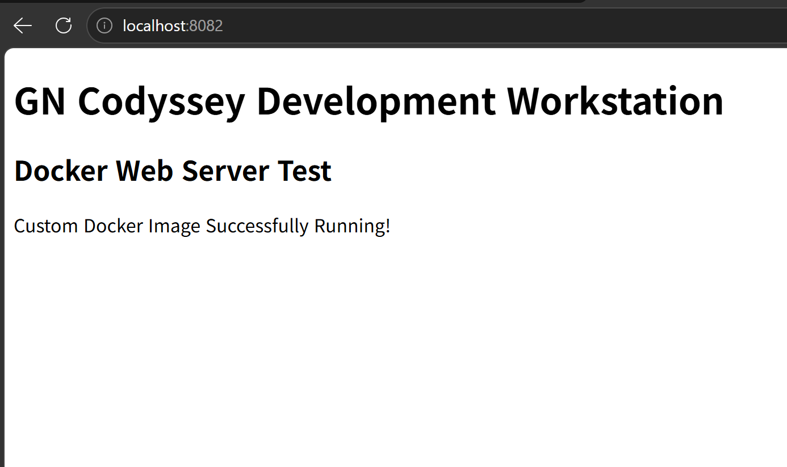 | 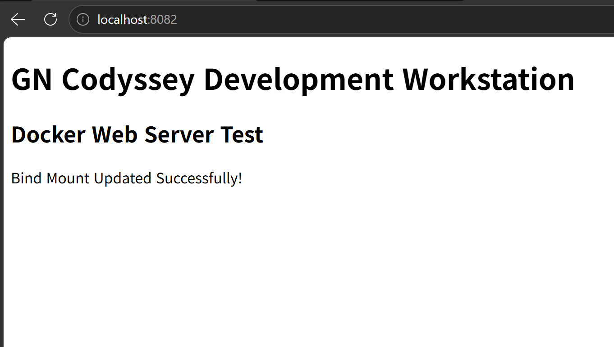 |
| `Custom Docker Image Successfully Running!` | `Bind Mount Updated Successfully!` |

**결론:** 이미지를 다시 빌드하거나 컨테이너를 재시작하지 않아도 변경된 HTML이 `localhost:8082`에 반영됐습니다.

**실행 증거:** [마운트 생성 로그](evidence/logs/05-bind-mount.txt) · [변경 후 curl 검증 로그](evidence/logs/08-bind-verification.txt) · [변경 전 HTML 백업](practice/index-before-bind.html)

---

## 8. Docker 볼륨: 컨테이너를 삭제해도 데이터 유지

**핵심 차이:** 바인드 마운트는 *지정한 호스트 경로*를 공유하고, 볼륨은 *Docker가 관리하는 스토리지*에 데이터를 보존합니다.

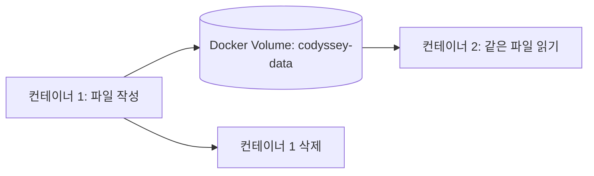

```bash
docker volume create codyssey-data
docker run -d --name codyssey-vol-1 -v codyssey-data:/data ubuntu:24.04 sleep infinity
docker exec codyssey-vol-1 sh -c 'echo "Persistent Data" > /data/test.txt'
docker exec codyssey-vol-1 cat /data/test.txt
# 출력: Persistent Data
docker rm -f codyssey-vol-1
docker run -d --name codyssey-vol-2 -v codyssey-data:/data ubuntu:24.04 sleep infinity
docker exec codyssey-vol-2 cat /data/test.txt
# 출력: Persistent Data
docker volume inspect codyssey-data
```

| 확인 시점 | 결과 |
|---|---|
| 컨테이너 1 삭제 전 | `Persistent Data` |
| 컨테이너 1 삭제 후, 컨테이너 2에서 읽기 | `Persistent Data` |

**결론:** 컨테이너를 삭제해도 별도로 관리되는 볼륨에는 데이터가 남았습니다.

**실행 증거:** [볼륨 생성·삭제·재연결 및 검증 로그](evidence/logs/06-volume.txt)

---

## 9. Git / GitHub / VS Code 연결

| 구성 | 역할 |
|---|---|
| Git | 로컬 작업 변경 사항 기록 및 버전 관리 |
| GitHub | 원격 저장소에 커밋 공유 |
| VS Code 소스 제어 | 수정 사항 확인, 스테이징, 커밋 이력 확인 |

```bash
git status
git remote -v
git branch --show-current
git add .
git commit -m "Add workstation verification evidence"
git push origin main
```

실제 `origin`은 [Jekt-o/GN_Codyssey](https://github.com/Jekt-o/GN_Codyssey)를 가리키며 `main` 브랜치에 실습 자료가 올라왔습니다.

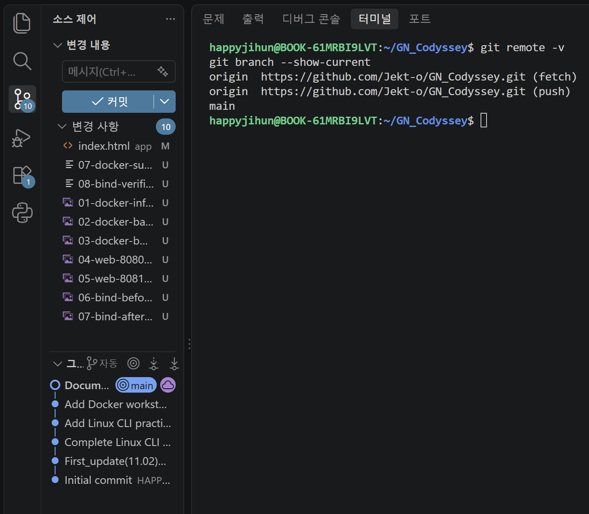

### Git 사용자 설정 및 기본 브랜치 검증

WSL Ubuntu에서 `git config --list`를 실행하고 관련 항목을 선별하여 이메일을 마스킹한 뒤, 현재 브랜치까지 함께 기록했습니다.

```text
$ git config --list (selected entries)
user.name=Jekt-o
user.email=[MASKED]
init.defaultbranch=main
$ git branch --show-current
main
```

**증거:** [09-git-config-safe.txt — Git 설정 검증 로그](evidence/logs/09-git-config-safe.txt)

### VS Code의 GitHub 계정 로그인 검증

VS Code 계정 메뉴에 **`Jekt-o (GitHub)`**가 표시되는 화면을 확인했습니다. 기존 소스 제어·원격 저장소 검증과 더불어 VS Code 내 GitHub 로그인 상태도 확인했습니다.

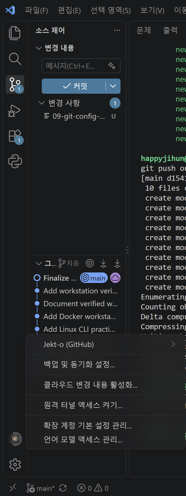

**증거:** [GitHub 로그인 스크린샷 원본](evidence/screenshots/09-github-login.png)

> 인증 코드는 일회용이며 비밀번호·토큰을 증거에 포함하지 않았습니다. `09-git-config-safe.txt`는 `git config --list`의 **전체 출력이 아닌 선별·마스킹본**입니다.

---

## 10. 실제 발생한 트러블슈팅

### 사례 1 — Docker 접근 권한 오류

| 단계 | 수행 내용 |
|---|---|
| **문제** | `docker run` 중 `permission denied ... /var/run/docker.sock` 발생 |
| **원인 가설** | Ubuntu 사용자에게 Docker 소켓 그룹 권한이 없음 |
| **확인** | `ls -l /var/run/docker.sock` → `root docker`, `id -nG` → 초기 그룹 목록에 `docker` 없음 |
| **해결** | `sudo usermod -aG docker "$USER"` 후 WSL 종료·재실행으로 그룹 변경 적용 |
| **재검증** | `id -nG`에 `docker` 포함, `docker ps` 정상 동작, `hello-world` 실행 성공 |

그룹 권한을 변경한 직후 기존 WSL 세션에서는 오류가 이어졌으나, **WSL 재시작 후 해결**됐습니다. Docker 그룹에는 높은 권한이 있으므로 개인 개발 PC의 설정 변경 시 주의가 필요합니다.

### 사례 2 — GitHub HTTPS 인증 실패

| 단계 | 수행 내용 |
|---|---|
| **문제** | `git push` 과정에서 GitHub 사용자 이름·비밀번호 요청 |
| **원인 가설** | WSL Ubuntu의 Git HTTPS 인증이 구성되지 않음 |
| **확인** | Git Credential Manager 명령을 찾지 못하고, 일반 계정 비밀번호 방식으로 진행할 수 없음을 확인 |
| **해결** | `gh auth login --web --git-protocol https` 실행, GitHub 기기 인증, `gh auth setup-git` |
| **재검증** | `git push origin main` 성공 및 GitHub 저장소의 실제 파일 업데이트 확인 |

인증 과정의 **일회용 코드, 비밀번호, 인증 토큰은 README와 증거에 포함하지 않았습니다.**

---

## 11. 재현 방법 및 주의사항

다른 PC에서도 다음처럼 동일한 웹 서버 이미지를 만들고 접속할 수 있습니다. Docker Desktop과 WSL 2·Docker 엔진을 먼저 준비해야 합니다.

### 포트 충돌 진단 및 해결 절차 — 평가 항목 #16

**가정한 오류 사례:** 이미 `8080` 포트를 쓰는 프로그램이 있는데 또 `-p 8080:80`으로 컨테이너를 실행하면 `port is already allocated` 또는 `bind: address already in use` 오류가 날 수 있습니다. 아래는 **실제로 발생했다고 주장하는 로그가 아니라, 재현·운영을 위한 진단 절차**입니다.

**1단계 — Docker에서 8080 포트를 사용 중인지 확인 (WSL Ubuntu 터미널)**

```bash
docker ps --format 'table {{.Names}}\t{{.Ports}}'
docker port gn-codyssey-web
```

`gn-codyssey-web`이 `0.0.0.0:8080->80/tcp`를 사용 중이라면 이 컨테이너가 이미 해당 포트를 게시하고 있다는 뜻입니다. **과제에서 사용한 컨테이너를 실수로 종료하지 않도록** 먼저 이름과 용도를 확인합니다.

**2단계 — Windows 호스트에서 점유 프로세스와 PID 확인 (Windows PowerShell)**

```powershell
netstat -ano | findstr :8080
Get-NetTCPConnection -LocalPort 8080 -State Listen -ErrorAction SilentlyContinue |
  Select-Object LocalAddress,LocalPort,OwningProcess
```

`LISTENING` 또는 `Listen` 항목의 **PID(프로세스 ID)**를 확인하고, 다음과 같이 실제 PID에 해당하는 프로그램을 조사합니다.

```powershell
# 1234는 예시 PID — 실제 출력 값으로 교체
Get-Process -Id 1234
```

WSL 내부의 프로세스도 의심된다면 Ubuntu에서 `sudo ss -ltnp 'sport = :8080'`으로 추가 확인할 수 있습니다. 다만 Docker Desktop이 Windows 쪽에서 포트를 게시하는 경우에는 **WSL의 `ss` 목록에 점유 프로세스가 보이지 않을 수 있으므로**, Windows PowerShell과 `docker ps`를 함께 확인합니다.

**3단계 — 충돌 해소 (아래 중 하나만 선택)**

| 방법 | 명령/조치 | 주의사항 |
|---|---|---|
| Docker 컨테이너가 사용 중 | `docker stop gn-codyssey-web` | 내가 관리하는 해당 컨테이너이고 **중지해도 괜찮은 경우에만** |
| Windows 프로그램이 사용 중 | 점유 PID와 프로그램 확인 → 프로그램 정상 종료 | 알 수 없는 프로세스나 시스템 프로세스를 무작정 강제 종료하지 않음 |
| 기존 서비스를 계속 유지 | 다른 호스트 포트를 사용: 아래 예제 | 내부 NGINX 포트 `80`은 그대로 유지 |

```bash
# 8080이 사용 중일 때: 호스트 포트를 8090으로 변경
docker run -d --name gn-codyssey-alt -p 127.0.0.1:8090:80 gn-codyssey-web:1.0

# 변경된 포트로 응답·매핑 확인
docker ps --filter name=gn-codyssey-alt
curl http://localhost:8090
```

`8090`도 비어 있어야 하며, 이미 `gn-codyssey-alt`라는 이름의 컨테이너가 있다면 다른 이름을 지정합니다. **가장 안전한 우선 대안은 기존 실행 환경을 유지하고 사용하지 않는 호스트 포트를 선택하는 것**입니다.

**공식 참고:** [Docker Desktop — Port already allocated 오류](https://docs.docker.com/desktop/troubleshoot-and-support/troubleshoot/topics/)

```bash
git clone https://github.com/Jekt-o/GN_Codyssey.git
cd GN_Codyssey
docker build -t gn-codyssey-web:1.0 .
docker run -d --name gn-codyssey-review -p 8080:80 gn-codyssey-web:1.0
curl http://localhost:8080
docker logs gn-codyssey-review
```

- 다른 프로그램이 8080 포트를 사용한다면 호스트 포트만 변경: `-p 8090:80`
- 동일한 컨테이너 이름이 있으면 새 이름을 사용하거나 기존 컨테이너를 확인한 뒤 정리
- 바인드 마운트의 `$(pwd)/app` 경로는 **프로젝트 루트에서 실행**한 경우의 예시
- 저장소에는 실행에 필요한 원본 코드가 들어 있으며, Docker 이미지 자체를 저장소에 업로드하는 구조는 아님
- 공개 저장소에 로그를 추가하기 전 비밀번호, 토큰, 인증 코드, 개인키 등 노출 여부 점검

## 12. 최종 보완 체크

- [x] 필수 소스·Dockerfile·실습 로그 9개·스크린샷 9개 GitHub 업로드
- [x] Docker 권한 오류 해결 뒤 성공 기록 보강
- [x] 포트 매핑 및 바인드 마운트 전후 화면 연결
- [x] 볼륨 영속성 검증 로그 연결
- [x] 트러블슈팅 2건 작성
- [x] 컨테이너 **네트워크 네임스페이스**와 포트 포워딩 원리 설명 (#13)
- [x] Docker/Windows 포트 점유 확인 → 프로세스 조사 → 중지 또는 포트 변경 절차 작성 (#16)
- [x] `git config --list` 주요 항목을 이메일 마스킹 후 로그로 보관
- [x] Git 기본 브랜치 `main` 설정 확인 및 VS Code GitHub 계정 로그인 증거 추가
- [ ] **선택 보완:** Windows 호스트의 정확한 버전(예: Windows 11 24H2) 확인 후 실행 환경 표에 기재

---

**실습 결론:** Linux CLI로 파일과 권한을 관리하고, Dockerfile로 재현 가능한 NGINX 이미지를 만들었으며, 네트워크 네임스페이스 격리와 포트 포워딩 원리를 설명하고, 포트 충돌 진단 절차를 문서화했습니다. 포트 매핑·바인드 마운트·Docker 볼륨을 통해 외부 접속과 데이터 저장 방식도 검증했습니다. 모든 핵심 산출물은 이 GitHub 저장소의 소스·로그·스크린샷에서 확인할 수 있습니다.


---

## 13. 보너스 과제 (선택)

> 필수 과제(1~12번)와 **별도로 진행하는 선택 실습**입니다. 실행·검증이 끝난 항목만 완료로 표시합니다.

### 13.1 Docker Compose 기초 — 단일 서비스 실행 ✅

**실습 목적:** 기존에는 `docker run` 명령에서 이미지·포트·실행 옵션을 직접 지정했습니다. 이제 실행 설정을 `compose.yaml`에 저장해, 같은 서비스를 간단한 명령으로 다시 실행할 수 있도록 합니다.

**핵심 개념 — '문서화된 실행 설정'이란?** 요리할 때 재료와 순서를 레시피에 적어 두면 다른 사람도 같은 요리를 만들기 쉽습니다. Docker Compose도 **서비스를 실행하는 데 필요한 설정을 YAML 파일에 기록**해서, 다른 개발자가 같은 구성을 다시 만들기 쉽게 하는 도구입니다. 서비스가 하나여도 사용 가능하고, 나중에는 여러 서비스를 함께 관리할 수 있습니다.

**실제 제출한 파일:** [compose.yaml](compose.yaml)

```yaml
services:
  web:
    build: .
    image: gn-codyssey-compose:1.0
    ports:
      - "127.0.0.1:8090:80"
    restart: unless-stopped
```

| 설정 | 역할 |
|---|---|
| `services.web` | 관리할 NGINX 웹 서버 서비스를 `web`이라고 지정 |
| `build: .` | 현재 프로젝트의 `Dockerfile`을 기준으로 이미지 빌드 |
| `image` | 빌드한 이미지 이름을 `gn-codyssey-compose:1.0`으로 지정 |
| `127.0.0.1:8090:80` | 호스트의 로컬 8090번 포트 → 컨테이너의 80번 포트 연결 |
| `restart: unless-stopped` | 자동 재시작 정책. 사용자가 명시적으로 중지한 경우에는 자동 재시작하지 않도록 설정 |

**실행 및 확인에 사용한 명령어**

```bash
cd ~/GN_Codyssey
docker compose version
docker compose config
docker compose up -d --build
docker compose ps
curl -i http://localhost:8090
```

| 검증 항목 | 실제 확인한 결과 | 판정 |
|---|---|---|
| Compose 명령 사용 가능 | `Docker Compose version v5.6.1` | PASS |
| 설정 파일 해석 | `docker compose config` 정상 출력 | PASS |
| 이미지 빌드 | `gn-codyssey-compose:1.0` 빌드 완료 | PASS |
| 서비스 실행 | `gn_codyssey-web-1`, 상태 `Up` | PASS |
| 포트 게시 | `127.0.0.1:8090->80/tcp` | PASS |
| 웹 서버 응답 | `HTTP/1.1 200 OK`, HTML 문서 반환 | PASS |

**증거 자료**

- [전체 검증 로그 — 10-compose-single.txt](evidence/logs/10-compose-single.txt) — Compose 버전, 설정, 실행 상태, HTTP 200 응답 기록
- [터미널 핵심 결과 — 10-compose-single.png](evidence/screenshots/10-compose-single.png)
- [브라우저 접속 화면 — 11-compose-web.png](evidence/screenshots/11-compose-web.png)

| 터미널: 컨테이너 상태와 응답 | 브라우저: 웹 페이지 접속 |
|---|---|
| 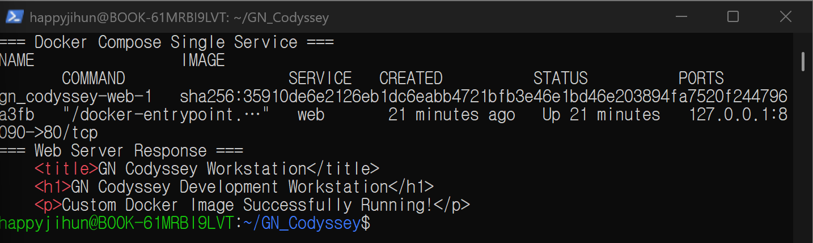 | 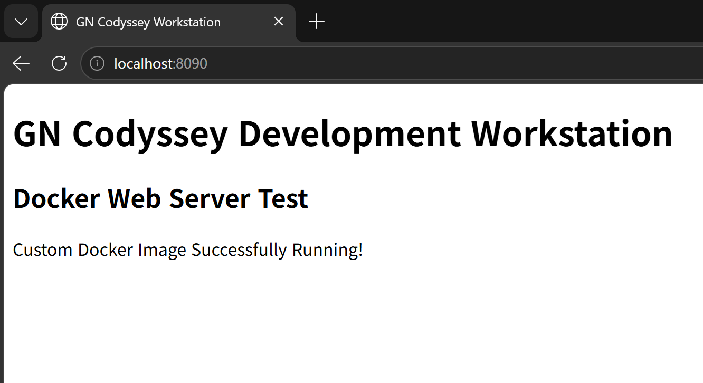 |

**왜 성공인가?** `docker compose config`는 설정 파일을 읽을 수 있다는 뜻이고, `docker compose ps`의 `Up`은 컨테이너가 실행 중임을 뜻합니다. 마지막으로 `curl`의 **HTTP 200**과 실제 HTML 응답을 통해, 컨테이너가 존재하는 데 그치지 않고 **웹 서버가 정상적으로 요청에 응답**한다는 사실까지 확인했습니다.

**배운 점:** `docker run`의 여러 실행 옵션을 사람이 기억하는 대신 `compose.yaml`에 보관하면, 실행 설정을 공유하고 동일한 구성을 재현하기 쉬워집니다. `Dockerfile`은 **이미지 내부에 무엇이 들어가는지**, `compose.yaml`은 **그 이미지를 어떤 서비스·포트·정책으로 실행할지** 정의한다는 차이도 확인했습니다.
